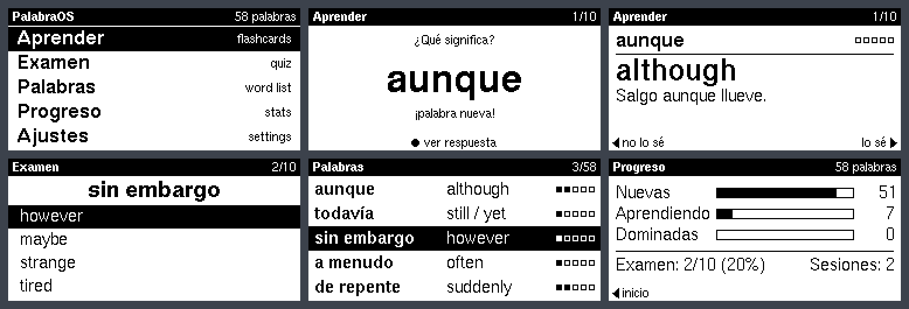

# PalabraOS

A tiny Spanish vocabulary trainer for a Seeed XIAO ESP32-S3, a WeAct Studio 2.13" e-paper
display (black/white, 250 x 122) and five buttons.



## Wiring

Pin names are the labels printed on the XIAO. All of them can be changed in `config.h`.

| E-paper pin | XIAO |   | Button | XIAO (other leg to GND) |
|-------------|------|---|--------|-------------------------|
| VCC         | 3V3  |   | UP     | D0 |
| GND         | GND  |   | DOWN   | D1 |
| SCL         | D8   |   | LEFT   | D2 |
| SDA         | D10  |   | RIGHT  | D3 |
| CS          | D9   |   | CENTER | D7 |
| D/C         | D6   |   |        |    |
| RES         | D5   |   |        |    |
| BUSY        | D4   |   |        |    |

- The display runs on **3.3 V**, not 5 V.
- Buttons need no resistors (internal pull-ups are used).
- All 11 XIAO pins are used. Keep buttons off D6: the chip sends start-up
  messages out of that pin.

## Arduino IDE setup

1. **Boards Manager**: install "esp32" by Espressif Systems.
2. **Tools > Board**: "XIAO_ESP32S3".
3. **Library Manager**: install `GxEPD2`, `U8g2_for_Adafruit_GFX` and
   `Adafruit GFX Library` (choose "Install all" for its dependencies).
4. Open `PalabraOS/PalabraOS.ino` (`config.h` and `words.h` sit next to it) and upload.

## Controls

| Button | Does |
|--------|------|
| UP / DOWN | move the highlight |
| CENTER | select / flip the card |
| LEFT | back - or "I didn't know it" on a flipped card |
| RIGHT | "I knew it" on a flipped card, next page in the word list |
| hold CENTER | Home from anywhere (on Home: clean the screen) |

## Apps

- **Aprender** - flashcards. Flip, then answer honestly: LEFT = no, RIGHT = yes.
- **Examen** - multiple-choice quiz on words you have already met.
- **Palabras** - browse the whole list with translations and examples.
- **Progreso** - how many words are new / being learned / mastered.
- **Ajustes** - direction (Spanish>English, English>Spanish, both),
  cards per session, erase progress.

Every word has a level from 0 (new) to 5 (mastered), shown as five small squares.
A right answer raises it by one, a wrong answer drops it back to 1. Low-level words
come up often, mastered ones rarely. New words are added a few at a time, in list order.
Progress is stored in the ESP32's flash and survives power-off.

## Your own words

Edit `words.h`. One line per word:

```cpp
{ "la pantalla", "screen", "La pantalla está rota." },
```

Add new words at the end to keep your progress. If you replace the whole list,
add 1 to `WORD_LIST_VERSION` in the same file.

## If something doesn't work

- **Nothing on the display**: re-check the wiring table, then try the other panel
  types listed at the top of `config.h`.
- **Upload fails**: hold the XIAO's tiny BOOT button while plugging in USB, then upload again.
- **Upside-down picture**: set `EPD_ROTATION` to 3 in `config.h`.
- **Driver messages**: set `DEBUG_BAUD` to 115200 in `config.h` and open the Serial Monitor.
